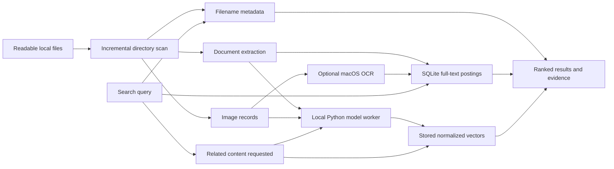

# Shiwa

Shiwa is a local file search application built with Go and Wails v2. A Spotlight-style floating search bar finds filenames, document text, source code and images. Keyword search uses SQLite indexes; optional semantic search uses EmbeddingGemma 2 on your own device.

**Official release packages include the model, Python runtime and inference dependencies.** Starting the application does not require downloading a model, installing Python or signing into Hugging Face. Build machines fetch these components before packaging, avoiding first-run download failures on restricted networks.

## Contents

- [Platform support](#platform-support)
- [Using the application](#using-the-application)
- [Configuration](#configuration)
- [How search and indexing work](#how-search-and-indexing-work)
- [Building from source](#building-from-source)
- [Complete offline packaging](#complete-offline-packaging)
- [Tests and continuous integration](#tests-and-continuous-integration)
- [Performance and limitations](#performance-and-limitations)
- [Source organization](#source-organization)
- [Troubleshooting](#troubleshooting)

## Platform support

| Platform | Release targets | Desktop requirements |
| --- | --- | --- |
| macOS | Apple Silicon / ARM64 | CI packages target macOS 15 or later; Intel releases are not supported |
| Windows | x64 and ARM64 | Microsoft WebView2 Runtime |
| Linux | x64 and ARM64 | Ubuntu 24.04-compatible GTK 3, WebKitGTK 4.1 and X11 libraries |

The five-target release workflow is configured. Native macOS builds and offline text/image inference have been validated locally; Windows applications have been cross-compiled. Windows/Linux native inference, including the Windows ARM64 dependency source build, still require their native CI runners. Configuration of a release target is not a claim that its platform acceptance testing has passed. See [validation records](docs/VALIDATION.md).

macOS packages use an ad-hoc signature and are not Apple-notarized. Windows packages are unsigned portable archives. Linux global shortcuts currently require X11; native Wayland shortcut support is not implemented.

## Using the application

1. Extract the complete archive. On macOS, move the application bundle to Applications. On Windows/Linux, keep `Resources` beside `Shiwa.exe` or `Shiwa`.
2. Launch the application. The first run automatically adds your home directory and discovers mounted local disks. Only readable, non-excluded files are indexed.
3. Type a filename or content phrase. Filename results appear first; eligible queries then retrieve indexed text without waiting for the semantic model.
4. Expand **Related content** when you want model-based suggestions. Descriptions such as `photos of a sunset at the beach` can retrieve images by visual content, without requiring those words in the filename.
5. Open Settings to manage indexed folders, language, OCR, semantic search, code editor and the global shortcut.

The search window starts as a compact input bar and expands when needed. Drag the search icon or the edges above/below the input to move it. Hiding the window keeps indexing running. Use the application menu or Settings to quit.

macOS provides a menu-bar icon and Dock reopening. A second application launch brings the existing instance forward. Windows/Linux do not currently have the same native tray integration or automatic startup support.

### Keyboard controls

| Action | macOS | Windows/Linux |
| --- | --- | --- |
| Show search from another application | `Control+Q`, configurable | `Ctrl+Q`, configurable |
| Select a result | `Up` / `Down` | `Up` / `Down` |
| Open selected result | `Enter` | `Enter` |
| Reveal the file | `Command+Enter` | `Ctrl+Enter` |
| Toggle preview | `Command+Y` | `Ctrl+Y` |
| Open Settings | `Command+,` | `Ctrl+,` |
| Focus the search input | `Command+K` | `Ctrl+K` |
| Next / previous file-type tab | `Tab` / `Shift+Tab` | `Tab` / `Shift+Tab` |
| Dismiss preview, leave Settings or hide search | `Esc` | `Esc` |
| Quit from the application menu | `Command+Q` | `Ctrl+Shift+Q` |

Tab cycling applies while a query is present. Settings and input-method composition keep normal Tab behavior. Control and Command are distinct keys on macOS; the default global launcher shortcut uses Control.

## Configuration

### Settings in the application

| Setting or action | Default | Behavior |
| --- | --- | --- |
| Interface language | Simplified Chinese | Select English or Simplified Chinese; updates the UI, window title and native menus |
| Indexed folders | Home directory and discovered local disks | Add folders or remove their indexes; source files are never deleted |
| Update index / Pause scan | Automatic background refresh | Start an incremental scan or cancel the current scan |
| Semantic search | On | Loads the bundled model and generates pending vectors; switching off stops the worker but retains keyword search and stored vectors |
| Image text recognition (OCR) | Off | Opt-in offline recognition on macOS; unavailable and visibly disabled on Windows/Linux |
| Recognize image text again | Manual | Retry image recognition while OCR is enabled |
| Code editor | System default app | Choose an installed supported editor for code files and matching-line navigation |
| Open search anywhere | `Ctrl+Q` | Record and save a replacement global shortcut |
| Load model / Pause model | Model loads when enabled and bundled | Start or stop local inference |
| Index remaining content | Manual | Retry pending vector generation; existing vectors are retained |

Returning from Settings preserves the current results, selection and completed preview. OCR is independent of semantic search: pausing OCR retains already recognized searchable text and does not remove image vectors.

Supported editor IDs are `code` (VS Code), `cursor`, `zed`, `subl` (Sublime Text), `goland` and `idea` (IntelliJ IDEA). macOS also checks standard application installation paths; other platforms resolve editor commands through `PATH`. Content hits reopen code at a matching line after rereading the current file. Filename-only hits open without a line number. Code excerpts retain indentation and line numbers, but do not currently provide syntax coloring.

Shortcut recording accepts Ctrl, Alt, Shift and the platform system modifier, with a letter, digit, Space or F1-F12. At least Ctrl, Alt or the system modifier is required. The persisted system-modifier name is `Meta`, displayed as Command, Win or Super. A conflicting shortcut or failed settings save leaves the old binding active: registration, persistence and release happen transactionally.

### Data directory and saved preferences

Shiwa uses the historical `Localens` directory name to preserve existing installations:

| System | Default application data directory |
| --- | --- |
| macOS | `~/Library/Application Support/Localens` |
| Windows | `%APPDATA%\Localens` |
| Linux | `$XDG_CONFIG_HOME/Localens`, or `~/.config/Localens` when unset |

`LOCALENS_DATA_DIR` overrides the directory. It contains `index.db`, SQLite sidecar files while in use, `settings.json`, the extracted inference worker and the `default-scope-v2` discovery marker. Indexed roots live in the database, not in `settings.json`.

The preference file has this shape; the example selects English while keeping the other default choices:

```json
{
  "language": "en",
  "semanticEnabled": true,
  "ocrEnabled": false,
  "shortcut": "Ctrl+Q",
  "editor": ""
}
```

`editor: ""` means the system default application. The optional legacy `python` key is for source/development environments without bundled assets; complete releases prefer their own interpreter and do not require this field. When the preference file is absent, the defaults in the Settings table apply. Use Settings for normal changes. If editing the file manually, stop Shiwa first and restart afterward; there is no live configuration-file watcher. Settings are written through a temporary file and rename.

Unchanged polling scans keep visited row IDs in memory and do not update document rows or grow the SQLite WAL merely to mark files as seen. New or modified files still grow the index: extracted text, full-text postings, chunk metadata and semantic vectors all consume disk space. Compaction can reclaim unused pages, but cannot remove live indexed content.

The database contains extracted text, OCR output and vectors. It is local storage, not an encrypted vault. Keep application data under your normal account protections.

### Environment variables

These variables support development and testing; complete offline releases do not need them for normal use.

| Variable | Scope | Meaning |
| --- | --- | --- |
| `LOCALENS_DATA_DIR` | Application startup | Override the application data/index directory |
| `LOCALENS_INDEX_HOME` | Initial scope discovery | Replace the home directory used for first-run indexing; when set without a volume override, suppress automatic disk discovery |
| `LOCALENS_INDEX_VOLUMES` | Scope discovery | Override discovered volumes with an OS path-list: `:` on macOS/Linux, `;` on Windows |
| `LOCALENS_MODEL_PATH` | Standalone/development worker | Load model files from a local directory; bundled workers set this to their own model and replace inherited overrides |
| `HF_HOME` | Development worker | Hugging Face cache location; a project virtual environment defaults to the project `.models` directory when this is unset |
| `HF_HUB_OFFLINE`, `TRANSFORMERS_OFFLINE` | Development worker | Disable remote model resolution; both are forced to `1` for bundled inference |
| `LOCALENS_TEST_PYTHON` | Opt-in integration test | Interpreter with the real model dependencies; enables `TestRealLocalModel` |
| `LOCALENS_TEST_IMAGE` | Opt-in integration test | Optional image fixture used by the real-model integration test |
| `LOCALENS_PERF_DB` | Opt-in performance test | Database path for the real filename-latency test; use a copy with the desktop app stopped |

Scope variables do not clear existing roots or reset discovery history. For an isolated development run, use a fresh data directory as well as the scope override. This example indexes a dedicated fixture directory instead of your normal home:

```sh
mkdir -p /tmp/shiwa-demo-files
LOCALENS_DATA_DIR=/tmp/shiwa-demo-data \
LOCALENS_INDEX_HOME=/tmp/shiwa-demo-files \
./build/bin/Shiwa
```

On Windows, set equivalent variables in PowerShell before starting the executable:

```powershell
New-Item -ItemType Directory -Force "$env:TEMP\shiwa-demo-files" | Out-Null
$env:LOCALENS_DATA_DIR = "$env:TEMP\shiwa-demo-data"
$env:LOCALENS_INDEX_HOME = "$env:TEMP\shiwa-demo-files"
.\build\bin\Shiwa.exe
```

### Fixed implementation parameters

The following are code-level limits, not user settings or supported environment overrides:

| Parameter | Current value |
| --- | --- |
| Background scope/scan check | Every 30 seconds; an occupied scan/model worker can defer work |
| Keyword result page | Up to 80 results |
| Search input limit | 500 Unicode characters and 16 whitespace-separated terms |
| Text extraction | Plain text and PDF output: up to 512 KiB; DOCX: up to 2 MiB of XML input with a 512 KiB text accumulation target |
| PDF extraction | First 100 pages, using an external `pdftotext` executable |
| Document chunks | Up to 96; 1,200 characters each, with 150-character overlap |
| Text preview | Up to 6,000 Unicode characters |
| Editor line lookup | Rereads code files up to 2 MiB; larger files open without a line target |
| Image preview | Files up to 12 MiB |
| OCR input | Up to 32 MiB; at most 20,000 pixels per axis and 80 megapixels; thumbnails up to 2,400 pixels |
| Embedding format | 256-dimensional, normalized float32 vectors on CPU |
| Semantic candidate threshold | Dot product at least `0.65`; a relevance heuristic, not a confidence probability |
| Evidence loading | At most four goroutines for the final result page |

## How search and indexing work



### Supported content

| File type | Keyword retrieval | Semantic retrieval |
| --- | --- | --- |
| TXT, Markdown, CSV, JSON, YAML, TOML and logs | UTF-8 document text | Text chunks |
| Supported code, HTML and CSS extensions | UTF-8 text, highlighted code excerpts and line navigation | Text chunks |
| DOCX | Text from `word/document.xml` | Extracted text chunks |
| PDF | Text extracted by external `pdftotext` | Extracted text chunks |
| JPEG, PNG, WebP, GIF and BMP | Filename; recognized image text when macOS OCR is enabled | Visual image vectors |
| Supported video/audio extensions | Filename | Not supported |
| Other regular files | Filename | Not supported |

Files with missing or failed text extraction keep filename records. A document without extracted text can still have a filename-based fallback embedding; that is not an understanding of unread document contents.

### Discovery and synchronization

The scanner uses normal directory traversal rather than NTFS MFT/USN indexing or filesystem event subscriptions. It records path, filename, type, size and modification time, then re-extracts changed content. Non-document files directly inside a root are registered before large subtrees, so visible media can become searchable while the rest of a library is still scanning.

Hidden directories, application bundles, `node_modules`, `vendor`, `__pycache__`, the app's data directory and recognized bundled model resources are excluded. Protected system directories at disk roots are skipped. On macOS, Library traversal preserves CloudStorage and Mobile Documents while excluding other application data. Symbolic links are not followed, and overlapping roots are rejected.

Deleted-file records, associated chunks/vectors and full-text postings are removed as completed scans reconcile each root. Deletion is therefore eventually synchronized, not instantaneous. Canceled scans preserve unvisited records; inaccessible subtrees preserve their old entries rather than treating permission failures as deletions. Other readable parts of the root still reconcile normally. Removing an indexed folder deletes its index records only.

On macOS, cloud placeholders receive filename records without forcing a content download. When the file becomes local, a later scan can add its text and vectors. Extraction failures retain filename search and appear as indexing warnings.

### Keyword retrieval and ranking

A separate metadata table serves filename lookup without reading document bodies. Eligible content queries use SQLite FTS5 trigram postings to narrow candidates. An additional compact posting index handles short non-ASCII terms, including one- and two-character CJK queries. Literal Unicode-aware matching verifies candidates, so the full-text index is a prefilter rather than a replacement for exact matching.

Ranking favors exact filenames, complete filename phrases, complete body phrases and then scattered-term matches. For example, `while True` prioritizes that contiguous phrase over files containing `while` and `true` in unrelated places. Parent-directory paths are displayed as locations and are not searched as ordinary content. Short Latin keywords use a filename word-prefix policy to reduce incidental substring matches; short queries, explicit filenames and media filters can bypass body or model retrieval.

The phrase path pages lightweight candidate metadata in batches of 512, with an 8,192-candidate probe budget. A complete fallback handles cases where that fast path is insufficient; the probe budget does not silently discard the remaining result domain. Queries with common words can still require substantial verification.

Only the final result page loads text/code evidence, using up to four workers. Metadata cursors close before body reads to avoid connection-pool starvation. Current file metadata and match eligibility are rechecked before snippets are shown. Results explain matches with highlighted passages or code excerpts rather than relying on generic relevance labels.

Full-text backfill runs in small restartable transactions. Pending bodies remain in a fallback search path, while insert/update/delete triggers maintain postings for subsequent changes. External-content indexes reuse the stored document body. Stable explicit document IDs preserve posting identity across compaction.

### Semantic text and image retrieval

Go manages a persistent Python subprocess through a serialized JSONL request/response protocol. The worker loads EmbeddingGemma 2 once and handles query, document and image requests. Queries use the model's `SearchQuery` prompt; images are passed through the visual encoder, not reduced to filenames or OCR text.

The model runs on CPU in float32 and returns normalized 256-dimensional vectors. Document embeddings include the filename as a title alongside the chunk text. Chunks reference Unicode ranges in the stored body, avoiding a duplicate copy of every passage. Images have their own vectors. Query retrieval currently uses an exact scan of stored vectors, not an approximate nearest-neighbor index.

The default UI returns keyword matches without model inference. **Related content** explicitly requests model suggestions; keyword results remain above the additional suggestions. Semantic suggestions require the model to be ready and the query to be eligible. Very short keywords, paths, filename-like queries and audio/video searches are gated to avoid meaningless model matches.

Bundled workers use the package's local model path, offline flags, isolated Python settings and disabled Hugging Face telemetry. No user documents are sent to an online inference endpoint. The distributed weights omit unused audio tensors while retaining text/vision tensor bytes; this does not add audio understanding or video frame analysis.

### Image OCR

macOS uses Apple Vision and bounded ImageIO thumbnails to recognize Chinese and English text locally. OCR is optional and off by default. Recognized text enters the same keyword index and snippet pipeline as document text. File changes reset recognition state; stale results are rejected after metadata is rechecked. Pausing OCR retains searchable recognized text and existing image vectors.

Semantic image retrieval and OCR solve different problems: a visual description can match the scene, while OCR can match words printed inside a screenshot. Windows/Linux currently support filename and semantic image search but have no OCR backend; Settings marks that limitation and disables OCR controls.

### UI caching and cancellation

The frontend caches completed results per visited file-type tab for the current normalized query. Returning to a cached tab restores results, selection, scroll position and completed related results without rerunning the search. An uncached tab performs its own search rather than filtering the capped All result page.

Query/scope/index/preference changes invalidate the appropriate cache. Model readiness alone preserves keyword caches. Search generation IDs and Go contexts prevent late results from replacing newer queries or tabs. Background refreshes retain visible results without showing the foreground loading indicator.

## Building from source

Run commands from the directory containing this README, `go.mod` and `wails.json`. Use Go 1.24 or later and the Wails v2 native development prerequisites. CI uses a current stable Go toolchain, Node.js 24 and Python 3.13. The frontend is plain HTML/CSS/JavaScript and has no npm build step.

On macOS, install the Apple command-line development tools. On Ubuntu 24.04, the CI dependency set is:

```sh
sudo apt-get update
sudo apt-get install -y build-essential pkg-config libgtk-3-dev \
  libwebkit2gtk-4.1-dev libx11-dev xvfb xauth
```

Build on macOS/Linux:

```sh
sh scripts/build.sh
```

Build on Windows using the same Python tooling entry point as CI:

```powershell
$env:CGO_ENABLED = '0'
python scripts/ci.py build
```

Outputs are under `build/bin`: the macOS application bundle and executable, `Shiwa.exe` on Windows, or `Shiwa` on Linux. The macOS script builds Wails production code directly and ad-hoc signs the bundle. The Linux script selects the `webkit2_41` build tag when WebKitGTK 4.1 is available. The thin root `main.go` also preserves Wails CLI compatibility.

A source build compiles the program; it does not automatically assemble the complete model/runtime distribution. For a development interpreter, run the appropriate setup script:

```sh
sh scripts/setup-model.sh
```

```powershell
.\scripts\setup-model.ps1
```

These scripts create `.venv` and install inference dependencies. Development model loading may download weights on its first use. This network requirement applies to developers preparing assets, not users of complete release packages. Setup scripts require internet access and uv or a compatible Python installation.

### Build configuration files

| File | Purpose |
| --- | --- |
| `go.mod` / `go.sum` | Go version, module identity and dependency versions |
| `wails.json` | Wails CLI application/output metadata and frontend directory; not user preferences |
| `build/darwin/Info.plist` | Base macOS bundle metadata; complete CI packaging applies the tag version, run number and macOS minimum |
| `engine/requirements.txt` | Dependency ranges used by development setup |
| `engine/requirements-lock.txt` | Version constraints used while preparing complete inference assets |
| `scripts/runtime_bundle.py` | Standalone Python, uv, model revision and Windows ARM64 torchvision source pins |
| `.github/workflows/checks.yml` / `release.yml` | Native target matrix, check tooling and complete-release gates |

`CI_TARGET_ARCH`, when supplied to the build helper, must match the native Go host architecture. The release workflow passes its version to the packaging command, and `GITHUB_RUN_NUMBER` supplies the macOS bundle build number. These are build-time controls, not desktop settings. Model revision changes must stay synchronized between preparation, package validation and final release verification.

## Complete offline packaging

Build on the native target architecture, then prepare the private runtime/model assets and package them:

```sh
python3 scripts/runtime_bundle.py
python3 scripts/package_release.py --version v0.1.1 --arch arm64
```

Use `python` on Windows and select the native `amd64` or `arm64` architecture. The example version is a packaging argument, not a claim that a GitHub release has been published. Runtime preparation refuses to overwrite existing `work/release-assets`. To reuse prepared resources, pass their absolute path with `--assets` to `package_release.py`.

Preparation uses CPython 3.12.12 and uv 0.9.10 in private build directories, constrains dependencies using `engine/requirements-lock.txt`, generates a platform-specific hash lock and installs with required hashes. Model revision is pinned to `914f7f89142e33e77833254d9c9b90c3cef7303b`. Windows ARM64 builds the missing torchvision dependency from pinned official source on its CI runner; users do not compile anything. License notices and dependency metadata are retained.

Packaging rejects incomplete model/runtime assets and wrong application/Python architectures. It reconstructs the distribution from known files and signs embedded macOS binaries. Before archiving, the relocated runtime must load the model with an empty cache and socket connections denied, then return normalized query, text and image vectors. An inference failure prevents a release archive; there is no stripped-package fallback.

Artifacts use `Shiwa-<version>-<system>-<arch>-full.zip` or `.tar.gz`, with SHA-256 checksums and `.smoke.json` inference reports. Full packages are intentionally larger than the executable alone. A local macOS ARM64 packaging test produced an approximately 871 MiB archive; other platforms can differ.

See [complete release instructions](docs/CI-RELEASE.md) for pipeline details and platform prerequisites.

## Tests and continuous integration

```sh
python3 scripts/ci.py lint
python3 scripts/ci.py test
```

The test entry point runs Go vet, Go tests, frontend regressions and Python packaging/runtime tests. Linux/macOS use Go race detection; Linux tests run under Xvfb because the shortcut backend requires X11. The `sqlite_fts5` tag selects the native macOS SQLite driver; other builds use the portable Go driver. Both use the same database format.

Real model integration is opt-in through `LOCALENS_TEST_PYTHON`; the regular suite does not require model weights. Real-index timing tests are opt-in through `LOCALENS_PERF_DB`. Use disposable fixtures or a copied index for development tests.

Branch pushes and pull requests run lint/tests and five native application builds. Version tags matching `v*` additionally prepare complete assets and require all five full packages, checksums and offline inference reports before publishing. Routine CI does not distribute incomplete application archives. Actions are commit-pinned; repository write permission is limited to the final publication job.

Upload this source directory as the repository root so GitHub discovers `.github/workflows`. No GitHub remote is configured in the current workspace, so hosted workflow success is still unverified.

## Performance and limitations

On the same local Apple Silicon index, with background scanning/inference stopped, the October 15, 2026 comparison measured `while True` at 13.21 seconds initially / 8.01 seconds repeated before optimization, versus 2.69 seconds / 0.73 seconds afterward. `return nil` took 131 ms in that run. These are catalog retrieval timings, not end-to-end UI latency or semantic inference benchmarks. Cold disks, concurrent indexing, common terms and fallback work can take longer. Windows/Linux performance has not been measured.

Current boundaries:

- Video/audio search matches filenames; there is no transcription, audio embedding or video-frame indexing.
- PDF text extraction requires `pdftotext` on `PATH`; it is not bundled by the release scripts. Missing extraction keeps the filename searchable. Scanned PDFs do not receive a PDF-page OCR pass.
- OCR is macOS-only. Image preview is bounded; text preview uses extracted content rather than native Quick Look.
- Vector search is exact, so its cost grows with the stored vector count.
- The scanner polls directory trees and cannot search files denied by OS permissions; it does not provide filesystem-level MFT/USN indexing.
- Auto-start, Windows/Linux native tray integration and Wayland global shortcuts are not implemented.
- Some backend diagnostic messages still use Chinese even when the UI is set to English.

## Source organization

```text
main.go                    Thin Wails-compatible entry point
internal/app/              Lifecycle, Wails API, settings and operation orchestration
internal/desktop/          Native shortcuts, menus, tray, window appearance and volumes
internal/catalog/          SQLite, scanning, extraction, ranking and result evidence
internal/embedding/        Persistent model process and JSONL protocol
frontend/                  UI and embedded static assets
engine/                    Python worker, embedded worker source and dependency constraints
scripts/                   Build, development setup, asset preparation and complete packaging
cmd/index-maintenance/     Offline database maintenance utility
docs/                      Architecture, implementation notes, validation and decisions
build/                     Platform bundle metadata and icons
```

`internal/app.Run` composes the application. `internal/desktop` receives callbacks and does not import the app. Frontend and worker assets are embedded by their owning packages. The browser calls the Wails binding `window.go.app.App`. Data paths, Go module `localens`, bundle identity and `LOCALENS_*` names remain compatible with earlier versions.

Further implementation notes: [architecture](docs/ARCHITECTURE.md), [content indexing](docs/CONTENT-INDEX.md), [bounded retrieval](docs/SEARCH-PIPELINE.md), [OCR configuration](docs/OCR-CONFIGURATION.md).

## Troubleshooting

| Symptom | What to check |
| --- | --- |
| An existing file is missing | Check indexed folders, filters, permissions, exclusions and scan progress; use Update index and allow the scan to complete |
| A deleted file is still listed | Wait for a successful reconciliation scan; canceled or inaccessible subtrees deliberately preserve prior records |
| A filename works but its text does not | Verify text extraction, the content-index queue and query eligibility; PDFs need `pdftotext` |
| Related content is unavailable | Enable Semantic search, wait for model readiness and pending vectors, and use a descriptive eligible query |
| Screenshot text is not searchable | On macOS, enable OCR and wait for recognition; Windows/Linux OCR is unavailable |
| The global shortcut does not work | Check the saved shortcut and registration error in Settings; try another combination if another application owns it |
| The model reports missing Python modules | Verify the complete archive was extracted with its Resources directory; a developer executable alone is not a complete distribution |
| A first search is slower | Cold storage, common-term verification, indexing and initial model loading can add latency; keyword search does not require model inference |

### Shared text fragments and offline migration

New catalogs store extracted text in content-addressed Unicode fragments. Identical fragments share their text and full-text postings; ordered per-file references preserve complete previews, snippets and code line numbers. Content-defined boundaries use 4K–16K characters, with up to 499 characters of overlap so supported queries of up to 500 characters still match across boundaries. A SHA-256 key is checked against the exact bytes before sharing. Deleting one file removes only its references; the last reference collects the fragment and its lexical postings. Semantic chunks and vectors remain per file because model input includes the filename.

Existing populated catalogs remain readable in their legacy format until an explicit offline migration. Estimate text savings without changing the catalog:

```sh
go run -tags sqlite_fts5 ./cmd/index-maintenance -db "$HOME/Library/Application Support/Localens/index.db" -analyze
```

The estimate includes fragment overlap, but excludes reference/index overhead and filesystem free-page reclamation. It is not a guaranteed final database size. To migrate, quit the desktop application, keep a backup of the closed database, then run:

```sh
go run -tags sqlite_fts5 ./cmd/index-maintenance -db /path/to/working-copy.db -deduplicate -verify-against /path/to/original.db
```

Migration changes schema, references and postings in one transaction; failures roll back. The maintenance process starts no background OCR or indexing. After compaction, `-verify-against` checks every file body and metadata row, every semantic chunk/vector, roots and foreign keys against the original. Use the optimized copy only after verification succeeds. Older application binaries cannot read the shared schema; restore the original database when rolling back to an older binary. The source files are never changed.

To reclaim unused SQLite pages without changing the storage schema, quit the desktop app, back up the data directory, and run the maintenance utility against the database:

```sh
go run ./cmd/index-maintenance -db "$HOME/Library/Application Support/Localens/index.db"
```

The example is for macOS; use the configured data-directory path on other systems. The utility can perform existing storage migrations before compaction, preserving stored text and vectors. It must not be run concurrently with the desktop application.

### Image result thumbnails

Image results show proportional thumbnails alongside the filename and path. Only
visible rows and a small scroll margin request previews, with at most two requests
running concurrently. Returning to recent results reuses a bounded in-memory cache;
no thumbnail files or additional database are created.

The backend verifies that each image is still indexed, unchanged, and locally
available before and after loading it. JPEG, PNG, GIF (first frame), BMP, and WebP
sources are decoded into JPEG previews with a maximum edge of 160 pixels. Sources
larger than 32 MiB or 32 megapixels, cloud-only placeholders, and unsupported formats
retain their image icon. The backend cache holds at most 192 thumbnails / 8 MiB;
the frontend retains at most 128 previews. Full previews remain available separately.
