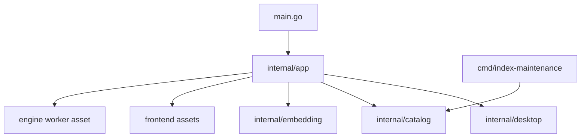

# Source organization and ownership

The source root contains a thin `main.go`, README, Go module files and Wails configuration. The entry point delegates to `internal/app.Run`. Keeping this file at the root preserves Wails CLI builds without maintaining a duplicate application entry point.

## Application layer

`internal/app` owns the Wails-bound `App` and coordinates existing services:

- `run.go`, `app.go`: Wails options, lifecycle, background state and status.
- `launcher.go`, `desktop.go`: launcher commands and desktop callback/lifetime wiring.
- `search.go`: keyword/semantic search requests and cancellation.
- `indexing.go`, `initial_index.go`: scan requests, OCR retries and index scope discovery.
- `model.go`, `bundled_model.go`: model lifecycle, vector generation and bundled runtime discovery.
- `files.go`, `editors.go`: verified previews, opening files and editor navigation.
- `preferences.go`, `shortcuts.go`: durable settings and transactional shortcut replacement.

Search ranking, SQLite candidates and evidence remain in `internal/catalog`, which owns the storage they query. The application layer only coordinates these calls. It does not duplicate the catalog behind an empty search package.

## Desktop boundary

`internal/desktop` owns OS adapters: window appearance, native menu/tray, global shortcut registration and mounted local volumes. It receives `Actions` callbacks and a context from the app; it never imports `internal/app`. The application owns its goroutine lifetime and persisted state. The desktop package owns native handles and callback bridges.

Objective-C files live alongside the Go files that declare their CGO interfaces. Darwin/Windows/Linux build constraints remain in place. Native shortcut cancellation and event tests live with those implementations; preference/registration transaction tests stay with the application.

## Resource ownership and frontend bridge

`frontend/assets.go` embeds only HTML, JavaScript and CSS from its own directory. `engine/assets.go` embeds only `worker.py`. This avoids parent-directory embed directives and keeps developer files out of the UI asset server. Neither resource package imports the application.

The bound Go type is `app.App`; JavaScript calls `window.go.app.App`. Regression tests verify the frontend namespace and static backend calls against the actual Go type, and verify that HTML asset references exist in the embedded filesystem.

## Build and data compatibility

Run `sh scripts/build.sh` or `python3 scripts/ci.py build` from the source root. The scripts also resolve the source root when invoked from another working directory. Development model setup lives in `scripts/setup-model.sh` and `scripts/setup-model.ps1`. Complete offline packaging and the five-platform release matrix remain under `scripts` and `.github/workflows`.

The Go module remains `localens` for compatibility. This refactor does not rename the Localens data directory, bundle identity, saved settings, database schema or model asset paths. Installed applications are not replaced merely to reorganize source files. Validation records are in [VALIDATION.md](VALIDATION.md).

Image result thumbnails are generated by `internal/thumbnail`, behind the
`App.GetThumbnail` binding and catalog scope/local-file checks. The frontend
`thumbnails.js` observer requests visible images with two concurrent jobs and
rejects obsolete render generations. Both caches are bounded and memory-only.
